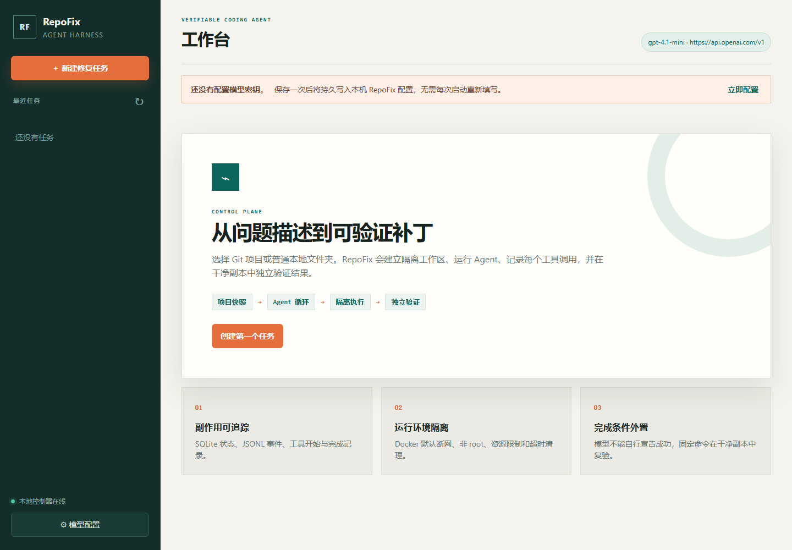

# RepoFix Harness

RepoFix 是一个面向 Python 项目修复的轻量级代码 Agent 运行框架。它为模型提供受控的文件与命令工具，持久化完整执行轨迹，管理大体积工具输出和上下文增长，支持中断会话恢复，并且只有在独立验证器能够于干净检出中复现补丁并通过验收后，才接受修复结果。

这个项目关注的重点不是应用层的 RAG 或工作流编排，而是模型外围的运行时工程：环境控制、副作用管理、上下文管理、状态持久化、完成条件和评测。



## 已实现功能

- 与具体框架无关的异步模型—工具循环，支持兼容 OpenAI Chat Completions 的模型服务。
- 本地浏览器控制台，可持久化模型配置、选择项目、创建任务，并查看实时轨迹、控制任务生命周期、检查验证状态和补丁。
- 使用分离式 Git Worktree 隔离任务，以原始基线提交生成补丁，并提供精确匹配编辑、修改文件数限制和禁止路径策略。
- 支持普通本地文件夹：先创建受管快照和私有 Git 基线，不修改原文件夹，并在快照中排除密钥与依赖目录。
- Docker 执行器默认禁用网络，使用非特权运行用户、移除 Linux capabilities、限制资源、支持超时与取消清理，并且只挂载一个可写工作区。
- 为可信测试与开发场景提供本地执行器。
- 使用 SQLite 保存会话状态、JSONL 追加式记录执行轨迹，并支持工具生命周期记录、大输出归档、任务取消、安全边界暂停/恢复和交接文档导出。
- 支持大输出卸载、确定性的上下文压缩、仓库目录映射，并保留压缩前的完整轨迹。
- 支持渐进式发现与加载项目 Skill，以及确定性的工具执行前后 Hook。
- 独立验证器会把候选补丁应用到干净克隆，注入 Agent 无法访问的保护测试，检查修改路径，并执行固定验收命令。
- 批量评测清单会汇总通过率、轮次、工具调用次数、耗时、补丁和轨迹。
- 使用确定性脚本模型实现离线单元测试与端到端测试。
- 在可信执行边界使用严格的 Pydantic 模型验证每个工具参数，不依赖模型侧是否遵守 JSON Schema。

## 执行流程

```text
问题描述 + 干净的 Git 仓库
        │
        ▼
分离式任务 Worktree ── 仓库映射 / Skills 目录
        │
        ▼
模型 → 经验证的工具调用 → 策略 + Hooks → Docker 命令或文件操作
  ▲                                      │
  └──────────── 持久化的结果 / 失败 ─────┘
        │
        ▼ submit_result
干净验证克隆 → 应用补丁 → 注入保护测试 → 执行固定命令
        │                                      │
        └──────────── 失败反馈 ─────────────────┘
                                               ▼
                                  补丁 + 轨迹 + 已验证结果
```

进一步说明请参阅[架构设计](docs/architecture.md)、[安全与执行边界](docs/security.md)和[评测指南](docs/evaluation.md)。版本历史记录在 [CHANGELOG.md](CHANGELOG.md)，贡献前检查参见 [CONTRIBUTING.md](CONTRIBUTING.md)。

## 安装与准备

环境要求：Python 3.11+、uv、Git，以及 Docker Desktop 或 Docker Engine。

```powershell
uv sync --group dev
docker build -f docker/runner.Dockerfile -t repofix-runner:py312 .
```

启动本地 Web 控制台：

```powershell
uv run repofix web
```

RepoFix 会打开 `http://127.0.0.1:8765`。首次使用时，在“模型配置”中保存 API 地址、模型名称和密钥；之后可在“新建修复任务”中选择 Git 项目或普通本地文件夹。服务只监听本机回环地址。

也可以在项目 `.env` 文件中（复制 `.env.example`）或通过环境变量配置任何兼容 Chat Completions 的模型服务：

```powershell
$env:REPOFIX_API_KEY = "..."
$env:REPOFIX_BASE_URL = "https://api.openai.com/v1"
$env:REPOFIX_MODEL = "gpt-4.1-mini"
```

模型服务凭据只保留在控制器中，不会传入任务容器。从 Web 控制台保存的设置会持久化到 `~/.repofix/.env`；API 向浏览器 JavaScript 返回配置时不会包含已保存的密钥。

## 运行修复任务

如果源项目是 Git 仓库，它必须处于干净状态，因为任务会从当前 `HEAD` 创建工作区。也可以直接选择普通文件夹：RepoFix 会将其复制为受管源快照、创建私有 Git 基线，并在不修改原文件夹的情况下完成任务。

```powershell
uv run repofix run `
  --repo D:\projects\sample-python `
  --issue "mean([]) raises ZeroDivisionError; return None and preserve existing behavior" `
  --accept "pytest -q"
```

默认镜像包含 Python、pytest、Ruff、Git、ripgrep 和 patch。如果目标项目需要其他依赖，请提前构建任务专用镜像并通过 `--image` 指定。默认网络策略下，任务运行期间无法在线下载依赖。`--executor local` 仅适用于可信代码。

常用生命周期命令：

```powershell
uv run repofix inspect SESSION_ID
uv run repofix resume SESSION_ID
uv run repofix verify SESSION_ID
uv run repofix cancel SESSION_ID
uv run repofix export-handoff SESSION_ID
uv run repofix replay SESSION_ID --output trace.json
uv run repofix cleanup SESSION_ID
```

运行数据默认保存在 `~/.repofix/`。可以设置 `REPOFIX_HOME` 或传入 `--home`，选择其他控制器目录：

```text
~/.repofix/
├── .env
├── repofix.sqlite3
├── sources/<session>/
├── workspaces/<session>/
├── sessions/<session>/events.jsonl
├── sessions/<session>/verification/
└── artifacts/<session>/candidate.patch
```

## 技术实现一览

| 关注点 | 实现方式 |
|---|---|
| Agent 运行时 | Python 3.11+、`asyncio`、强类型模型/工具协议、预算与循环保护 |
| 模型网关 | `httpx`、兼容 OpenAI Chat Completions、超时与瞬时故障重试 |
| 参数校验 | Pydantic 模型与工具 Schema |
| 操作界面 | Typer/Rich CLI、本地 REST API，以及无第三方依赖的 HTML/CSS/JavaScript 界面 |
| 持久化 | SQLite WAL、追加式 JSONL 轨迹和文件系统产物 |
| 源码隔离 | Git Worktree；为非 Git 文件夹创建私有 Git 快照 |
| 执行隔离 | Docker、非特权用户、禁用网络、移除 capabilities 和资源限制 |
| 独立验证 | 干净克隆、二进制补丁应用、保护测试和固定验收命令 |
| 扩展能力 | 渐进式 Skills 与确定性的生命周期 Hooks |
| 质量保障 | pytest、脚本模型端到端测试、Ruff 和 wheel/sdist 构建 |

## Skills 与 Hooks

RepoFix 初始只向模型提供 Skill 名称与描述。模型可按需调用 `load_skill` 加载完整指令，使未使用的内容不进入上下文。项目 Skill 可放在 `skills/<name>/SKILL.md` 或 `.repofix/skills/<name>/SKILL.md`，仓库内提供了两个示例。

Hook 是位于控制器侧、围绕工具执行与验证阶段运行的确定性扩展点。实现 `Hook` 协议并把 `HookManager` 传给 `AgentHarness` 后，Hook 可以拒绝操作、转换结果、写入审计数据，或在验证前执行额外规则。

## 异常恢复语义

RepoFix 会在产生副作用之前把工具调用记录为“已开始”，并在执行后记录结果。发生崩溃后，缺少完成记录的调用会被标记为“不确定”，且绝不会被静默重放。下一轮模型会收到这个不确定调用及持久化工作区，并需要检查实际状态。对于缺失的工具结果消息，运行时会重建明确的“不确定”或“未开始”结果，使恢复后的 Chat Completions 历史仍满足调用与结果配对协议。该设计不会假装任意副作用都能做到 exactly-once（恰好一次）。

模型调用本身无法确定性重放。`resume` 会从已保存的消息和文件继续运行，但不承诺复现此前的模型回答。

## 测试与评测

```powershell
uv run pytest -q
uv run ruff check .
uv run ruff format --check .
uv run python examples/offline_evaluation.py
```

当本机存在 `repofix-runner:py312` 镜像时，会运行 Docker 集成测试。端到端测试使用脚本模型修改真实 Git Worktree、执行测试、创建干净验证克隆、注入保护测试，并在不需要模型 API 密钥的情况下检查导出的补丁。

离线评测会执行两个确定性修复任务，并写入 `docs/evaluation-results/offline-latest.json`。它验证的是 Harness 与独立验证器，而不是模型的自主修复能力。评测真实模型时，应使用 `repofix eval` 和固定的私有或公开任务清单，并报告准确的模型、预算和任务集范围。

仓库还包含一份注明日期且已脱敏的[真实模型冒烟评测报告](docs/evaluation-results/real-model-smoke-2026-11-06.json)。报告包含两个合成任务各一次尝试的结果，不能解释为公开基准成绩或通用代码修复成功率。

## 重要限制

- 测试通过只表示符合这些测试覆盖的要求，不代表不存在其他缺陷。
- Docker 能提供实用的隔离，但不是针对恶意多租户环境的绝对安全沙箱。
- Web 端取消会通知进程内异步任务并触发执行器清理；另一个进程发出的 CLI 取消会在下一个运行时边界被观察到。执行器超时也会清理子进程或具名容器。已经完成的副作用无法自动回滚。
- 0.3 版本只运行单个控制器进程。SQLite WAL 可支持可靠的本地会话，但它不是分布式调度器。
- 内置评测器面向私有、可复现的任务集，不生成也不声称获得 SWE-bench 分数。
